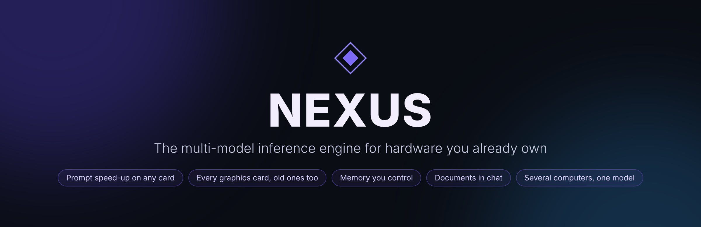

<p align="center">
  
</p>

<p align="center">
  <a href="LICENSE">
    
  </a>
  <a href="https://github.com/sjnettifee">
    
  </a>
</p>

<p align="center"><sub>Designed and built by <strong>Shea Nettifee</strong> — a year-long solo project.</sub></p>

Nexus is a free, local, multi-model inference engine built to get real
large-language-model performance out of hardware you already own: a
single modest graphics card, an old laptop, a spare desktop, or a CPU
alone. No cloud, no subscription, nothing leaves your machine.

📄 **[Read the intro (PDF)](docs/Nexus_Intro.pdf)**: a short overview
of what Nexus does and why, with a real-hardware benchmark.
📘 **[The Nexus Guide](docs/NEXUS_GUIDE.md)**: everything in one place, from
the first start to every server flag and API endpoint.

## What it does on ordinary hardware

The development machine is a desktop with **25 GB of DDR4**, a **3 GB GTX 1060**
from 2016 and a **$20 AMD R9 290** added as a helper card. On it, Nexus runs
**Qwen 3.6 27B** (4-bit):

- an **11,400-token prompt read in about 4½ minutes** (~42 tokens per second),
- prompts of **60,000 tokens** still read at over 30 tokens per second,
- **over 1 token per second** of writing afterwards,
- and the computer stays usable the whole time.

None of that hardware was meant to run a 27-billion-parameter model.

## What makes it different

- **Prompt speed-up (prefill acceleration).** While a prompt is read, the
  model's layers stream through a graphics card one at a time. A card
  far too small to hold the model still gives GPU-class prompt speed.
  It needs room for one layer.
- **Every graphics card you have, old ones too.** Mix cards of any brand
  and age. Each holds as many layers as you set, or as many as really fit.
- **Persistent memory.** Nexus never re-reads your chat history. Read a
  huge document once, and every follow-up skips that cost. Save the
  memory to disk and pick up exactly where you left off.
- **Several models at once**, each in its own slot with its own port,
  cards and settings.
- **Several computers, one model.** Split a model's layers across
  computers on your network. A small card on the main computer still
  speeds up prompts for the whole setup.
- **Portable.** One folder runs from a USB stick on Linux or Windows, on any
  x86 CPU from the last 15 years. It picks the fastest code your CPU supports.

## Conversation memory you control

Nexus never re-reads your chat history. Each message only adds what's new to the model's memory (the KV cache). You decide what stays in it:

- **Auto-trim.** When a conversation reaches its limit, the oldest messages are dropped and the chat keeps going. The system prompt is always kept.
- **Forget** any message, or several at once. It's gone from the model's memory, and everything after it shifts back exactly into place.
- **Archive** a message (for example *app.py rev 1*) as A1, A2, …, then **Restore** it later into this chat or another one, with no re-reading.
- **Copy** any message as Markdown, code blocks included.

Works with any model and chat format. See **[docs/CONVERSATION_MEMORY.md](docs/CONVERSATION_MEMORY.md)**.

## Drop in your documents

PDFs, Word files, spreadsheets, slides, e-books, RTF and web pages are read as text, right in the chat window, with OCR for scanned pages. It runs offline and works the same on every system. Drop a whole folder of specs and notes, and the model gets all of it, each file under its path. See **[docs/DOCUMENTS_IN_CHAT.md](docs/DOCUMENTS_IN_CHAT.md)**.

## Every graphics card you have, old ones too

- **Mix cards freely.** A 3 GB GTX 1060 reading prompts plus a $20 R9 290 holding layers runs a 27B model faster than either alone, and the computer stays usable during long prompts.
- **Maximize GPU:** fill each card with as many layers as really fit, or set the number per card. Long prompts still get the prompt speed-up.
- **Oversized-prompt protection:** when RAM runs short while reading a prompt, layers move to the card instead of the system swapping.
- **Measured, not guessed:** each card's 8-bit math and the CPU's 8-bit option can be left on Auto, which times both ways on your hardware and keeps the faster. Every speed setting has an on/off switch and a **?** explaining it.
- **Lossless speculative decoding (MTP)** for models that have draft heads.

See **[docs/GRAPHICS_CARDS_AND_SPEED.md](docs/GRAPHICS_CARDS_AND_SPEED.md)** and **[docs/MAXIMIZE_GPU.md](docs/MAXIMIZE_GPU.md)**.

## Safe on your network, easy to build on

- The web chat, your own apps and tools work from this computer and from other computers on your network with no setup.
- Websites on the internet can't use your models, even though your browser can reach them.
- An optional **API key** for other computers, set in the launcher's Network card. The computer running Nexus never needs it.
- A full HTTP/SSE API, and a C++ `Engine` class you can link directly.

How to call Nexus from your own program or web page: **[docs/ACCESS_AND_API_KEYS.md](docs/ACCESS_AND_API_KEYS.md)**. Every endpoint: **[docs/ENGINE_API_GUIDE.md](docs/ENGINE_API_GUIDE.md)**.

## Nexus Code Hardener

A companion tool that has local models read a whole codebase chunk by chunk, unattended:

- security audits, personal-info and notes sweeps, or your own prompt chains;
- a final report from your strongest model;
- follow-up questions to that model, with the memory saved alongside the report.

See **[nexus_harden_tool/README.md](nexus_harden_tool/README.md)**.

## Getting started

1. Download a release from the
   [Releases page](https://github.com/sjnettifee/nexus/releases) (or
   build from source, below) and unzip it anywhere, a USB stick included.
   Keep the folder together.
2. Drop a `.gguf` or `.nxm` model into the `models` folder next to the
   launcher, or point the launcher at your own model folder.
3. Start `nexus_launcher`. It picks graphics card settings for the model;
   change them if you like. Press **Start**, then **Open chat in browser**.

Full walkthrough: **[Launcher Guide](docs/LAUNCHER_GUIDE.md)**.

### Documentation

| Guide | What's in it |
|---|---|
| **[Nexus Guide](docs/NEXUS_GUIDE.md)** | The complete manual: every setting, flag, environment variable and endpoint, log lines, troubleshooting. |
| [Launcher Guide](docs/LAUNCHER_GUIDE.md) | The launcher window, card by card. |
| [Graphics cards and speed](docs/GRAPHICS_CARDS_AND_SPEED.md) | Several cards, 8-bit math, MTP, PCIe slots, reading the log. |
| [Maximize GPU](docs/MAXIMIZE_GPU.md) | Using card memory as extra room for very long prompts. |
| [Conversation memory](docs/CONVERSATION_MEMORY.md) | Limits, auto-trim, forget, archive, restore. |
| [Documents in chat](docs/DOCUMENTS_IN_CHAT.md) | PDF, Word, spreadsheets, slides, OCR. |
| [Access and API keys](docs/ACCESS_AND_API_KEYS.md) | Who can connect, API keys, building your own app. |
| [Engine / API Guide](docs/ENGINE_API_GUIDE.md) | Running headless, every HTTP endpoint, the C++ `Engine` class. |
| [Quant Builder Guide](nexus_quant_builder/README.md) | Converting Hugging Face models to Nexus's native `.nxm`. |
| [Changelog](docs/CHANGELOG.md) | What changed. |

## Troubleshooting

- **Windows: another device on my network can't connect.** Windows
  Defender Firewall asks the first time this happens. Click **Allow**,
  or it quietly blocks the connection with no error on the Nexus side.
  Missed the prompt? Go to **Windows Security → Firewall & network
  protection → Allow an app through firewall** and enable
  `nexus_server.exe` and `nexus_launcher.exe`.
- **Port 8080 won't bind / the model won't start.** Something else may
  already use it (common on Windows). Pick another port in the
  launcher's **Network** card.
- **Dropping a document says the readers are missing.** The `web/`
  folder isn't next to the server. Copy it there, or set `NEXUS_WEB_DIR`.
- **Prompts got slower after adding a second card.** Your motherboard
  probably split the first slot to x8. See
  [Slots and PCIe lanes](docs/GRAPHICS_CARDS_AND_SPEED.md#slots-and-pcie-lanes).
- Anything else: the **Log** tab says what happened, in plain words. The
  [Nexus Guide](docs/NEXUS_GUIDE.md#troubleshooting) has a longer list.

## What's in the repository

```
nexus/
├── README.md, LICENSE, NOTICE, THIRD_PARTY_LICENSES.md
├── CMakeLists.txt          engine + server build
├── src/                    the engine: model, GGUF/native loading, CPU kernels, Vulkan backend and shaders, API
├── tools/                  nexus_server, the CPU-tier dispatcher, and helper programs
├── nexusLauncher/src/      nexus_launcher (Dear ImGui; builds on its own with build.sh / CMake)
├── scripts/                build_release.sh and friends
├── tests/                  kernel, GPU and feature tests
├── web/vendor/             document readers for the web chat
├── docs/                   the guides, the Nexus Guide and the intro PDF
├── nexus_harden_tool/      the Code Hardener (Python)
└── nexus_quant_builder/    the Quant Builder (Python)
```

The compiled programs aren't in the repository; they're attached to each
[release](https://github.com/sjnettifee/nexus/releases). A release
download looks like this:

```
Nexus/
├── nexus_launcher          (nexus_launcher.exe on Windows)
├── server/                 nexus_server (the dispatcher), nexus_server_v2/v3/v4, libnexus_v2/v3/v4
├── web/vendor/             document readers (the server finds them one folder up)
├── docs/, nexus_harden_tool/, nexus_quant_builder/
└── README.md, LICENSE, NOTICE, THIRD_PARTY_LICENSES.md
```

The launcher finds the server next to itself or in a `server` folder
beside it. `models/`, `loras/` and `nexus-data/` are created on first
run.

## Building from source

Requires CMake 3.18+, a C++17 compiler, [Ninja](https://ninja-build.org/),
and a Vulkan shader compiler (`glslc` or `glslangValidator`) for GPU
support. Linux, macOS, or Windows (MSYS2 MinGW64 shell):

```sh
scripts/build_release.sh            # builds CPU tiers v2 v3 v4 -> ./dist
scripts/build_release.sh v3         # just one tier
OUT=/path/to/folder scripts/build_release.sh
```

This builds `nexus_server` (the small dispatcher every user actually
runs: built without `-march`, works on any CPU) plus a
`nexus_server_v2/v3/v4` + `libnexus_v2/v3/v4` pair for each CPU tier
(SSE4.2 / AVX2+FMA / AVX-512). The dispatcher picks the best one your
CPU supports at startup. Everything lands in `dist/` (and the project
folder), ready to zip or copy to a USB stick. Ship the `web/` folder
alongside it: it holds the document readers for the web chat.

Prefer driving CMake yourself:

```sh
cmake -S . -B build -G Ninja -DCMAKE_BUILD_TYPE=Release -DNEXUS_VULKAN=ON
cmake --build build --parallel
```

Useful CMake options: `-DNEXUS_TIER=v2|v3|v4|native`,
`-DNEXUS_VULKAN=ON` (GPU support, off by default), `-DNEXUS_CUDA=ON`
/ `-DNEXUS_ROCM=ON` (optional, off by default), `-DNEXUS_PYTHON=ON`
(pybind11 bindings, off by default).

## License

Nexus is released under the **GNU Affero General Public License v3.0**
(AGPLv3). See [`LICENSE`](LICENSE) for the full text,
[`NOTICE`](NOTICE) for copyright and authorship, and
[`THIRD_PARTY_LICENSES.md`](THIRD_PARTY_LICENSES.md) for the bundled
Dear ImGui and Roboto components. The web chat's document readers
(PDF.js, Tesseract.js, mammoth, SheetJS, JSZip) are unmodified
open-source libraries under Apache-2.0, BSD-2-Clause and MIT; their
versions and license texts are in `web/vendor/VERSIONS.txt` and
`web/vendor/LICENSES/`.

## Author

Nexus was designed and built by **Shea Nettifee**
([sjnettifee@gmail.com](mailto:sjnettifee@gmail.com)) over roughly a
year of solo development, with AI assistance (Claude, and earlier
development help from ChatGPT) used throughout as a development tool.
